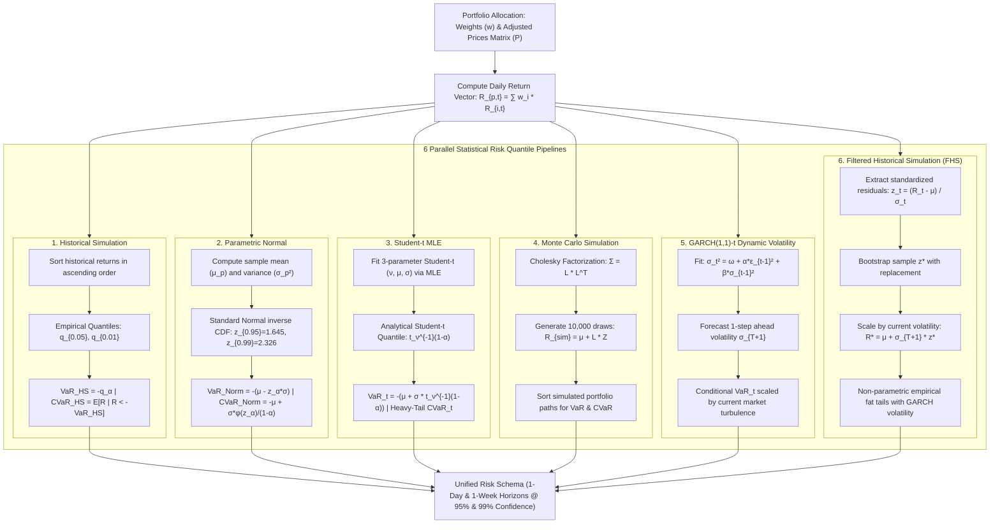
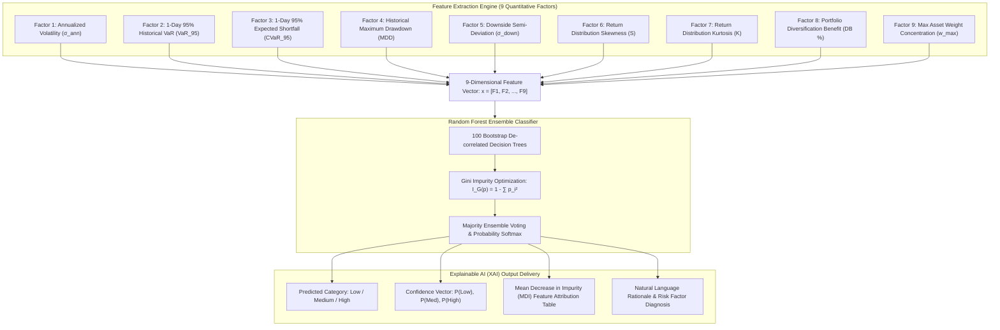
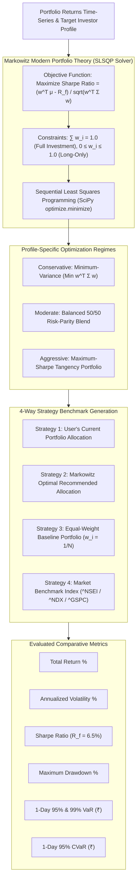
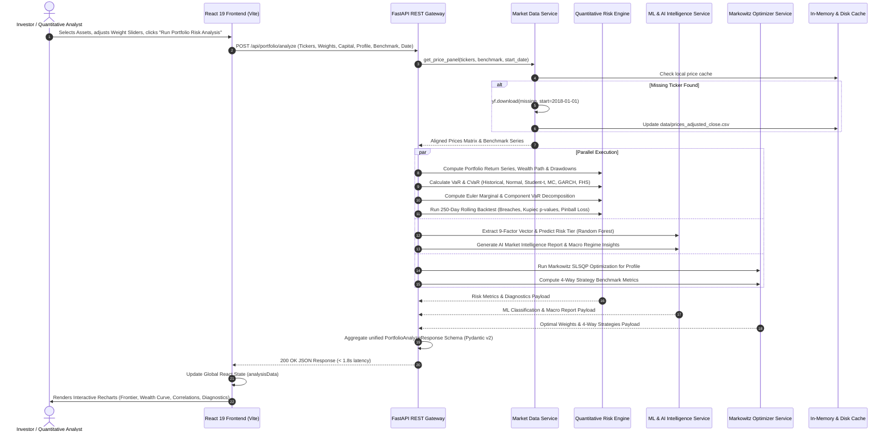

# End-to-End System Architecture: Investment Risk Intelligence Platform

---

## 1. Executive System Architecture

```mermaid
flowchart TD
    subgraph L1_Data ["1. Data Ingestion & Live Market Feed Layer"]
        direction TB
        YF["Yahoo Finance Live API (yfinance)"]
        NSE["NSE India & BSE Price Panels"]
        US_FEED["US & Global Feeds (NASDAQ / NYSE)"]
        MACRO["Indian Macro Feed (RBI Repo, Brent, USD/INR, CPI)"]
        
        SYNC_ENGINE["Live Sync Engine (POST /api/market-data/refresh)"]
        LOCAL_CSV[("Disk Cache: data/prices_adjusted_close.csv")]
        MEM_CACHE[("In-Memory Price Panel & Ticker Cache")]

        YF --> SYNC_ENGINE
        NSE --> SYNC_ENGINE
        US_FEED --> SYNC_ENGINE
        MACRO --> SYNC_ENGINE
        SYNC_ENGINE --> LOCAL_CSV
        LOCAL_CSV --> MEM_CACHE
    end

    subgraph L2_DataPrep ["2. Time-Series Alignment & Returns Engine"]
        direction TB
        INNER_ALIGN["Strict Date-Intersection Inner Alignment (Zero Look-Ahead)"]
        LOG_RET["Daily Continuous Compounded Log-Returns (r_t = ln(P_t / P_{t-1}))"]
        COV_MAT["Empirical Covariance Matrix (Σ) & Pearson Correlation Matrix (ρ)"]
        PORT_WEALTH["Portfolio Wealth Curve & Underwater Drawdown Generator"]

        MEM_CACHE --> INNER_ALIGN
        INNER_ALIGN --> LOG_RET
        LOG_RET --> COV_MAT
        LOG_RET --> PORT_WEALTH
    end

    subgraph L3_Quant ["3. Multi-Model Quantitative Risk Engine"]
        direction TB
        subgraph Models ["6 Core Statistical Risk Models"]
            M_HIST["Historical Simulation (Non-Parametric)"]
            M_NORM["Parametric Normal (Gaussian Integral)"]
            M_T["Student-t MLE Distribution (Heavy Tails)"]
            M_MC["Monte Carlo (10,000 Cholesky Correlated Paths)"]
            M_GARCH["GARCH(1,1)-t Conditional Volatility (arch)"]
            M_FHS["Filtered Historical Simulation (FHS Bootstrap)"]
        end

        subgraph Decomp ["Euler Risk Attribution"]
            EULER_MVAR["Marginal VaR: ∂VaR/∂w_i = (Σw)_i / σ_p * z_α"]
            EULER_CVAR["Component VaR: w_i * MVaR_i"]
            RC_RATIO["Risk-to-Weight Contribution Ratio (Diversifier vs Driver)"]
        end

        subgraph Validation ["Dynamic Out-of-Sample Backtesting"]
            OOS_WIN["250-Day Rolling Out-of-Sample Window"]
            KUPIEC["Kupiec POF Likelihood Ratio Test: LR_POF ~ χ²(1)"]
            PINBALL["Quantile Pinball Loss Proper Scoring Rule"]
        end

        PORT_WEALTH --> Models
        PORT_WEALTH --> Decomp
        PORT_WEALTH --> Validation
    end

    subgraph L4_AI_ML ["4. Machine Learning & AI Intelligence Layer"]
        direction TB
        subgraph ML_Risk ["9-Factor ML Risk Classifier"]
            FEAT_EXTRACT["9-Factor Feature Extractor (Vol, VaR, CVaR, MDD, Skew, Kurt, etc.)"]
            RF_MODEL["Random Forest Classifier (100 Trees Ensemble)"]
            PROB_DIST["Softmax Class Probability (Low / Medium / High)"]
            XAI["Feature Importance Attribution (MDI)"]
            FEAT_EXTRACT --> RF_MODEL --> PROB_DIST --> XAI
        end

        subgraph AI_Macro ["AI Market Intelligence & Sentiment"]
            MACRO_STATE["Macro Regime Classifier (Interest Rate & Inflation Regimes)"]
            SECTOR_EXP["Portfolio Sector Concentration Engine"]
            CATALYST["Asset-Specific Catalysts & Risk Warnings Generator"]
            MACRO_STATE --> CATALYST
            SECTOR_EXP --> CATALYST
        end

        PORT_WEALTH --> ML_Risk
        MACRO --> AI_Macro
    end

    subgraph L5_Optimizer ["5. Markowitz Optimization & Stress Lab"]
        direction TB
        SLSQP["Sequential Least Squares Programming (SLSQP Optimizer)"]
        PROFILES["Target Risk Profiles: Conservative, Moderate, Aggressive"]
        STRAT_4WAY["4-Way Strategy Benchmark (User vs Optimal vs 1/N vs Index)"]
        
        CRISIS_REPLAY["Crisis Replay (COVID-19 2020, 2022 Rate Hike, Flash Crash)"]
        CUSTOM_SHOCK["Interactive Elasticity Shock Simulator (-1% to -40%)"]

        PORT_WEALTH --> SLSQP --> PROFILES --> STRAT_4WAY
        PORT_WEALTH --> CRISIS_REPLAY
        PORT_WEALTH --> CUSTOM_SHOCK
    end

    subgraph L6_API ["6. High-Performance REST API Layer (FastAPI)"]
        direction TB
        ENDPOINT_ANALYZE["POST /api/portfolio/analyze"]
        ENDPOINT_STRESS["POST /api/portfolio/stress-test"]
        ENDPOINT_REFRESH["POST /api/market-data/refresh"]
        ENDPOINT_ASSETS["GET /api/assets"]
        ENDPOINT_DEMO["GET /api/portfolio/demo"]
        ENDPOINT_HEALTH["GET /api/health"]

        PYDANTIC["Pydantic v2 Schema Validation & Rust Serialization Engine"]
        CORS["Cross-Origin Resource Sharing (CORS) Middleware"]

        L3_Quant --> PYDANTIC
        L4_AI_ML --> PYDANTIC
        L5_Optimizer --> PYDANTIC
        PYDANTIC --> ENDPOINT_ANALYZE
    end

    subgraph L7_UI ["7. Frontend Client Application (React 19 + TypeScript + Vite)"]
        direction TB
        NAVBAR["Navbar (Live Feed Pulse, Data As-Of, 1-Click Sync Button)"]
        
        TAB_OVERVIEW["Overview Tab: Portfolio Cards, ML Classification, Macro Intelligence, Alpha/Beta"]
        TAB_BUILDER["Portfolio Builder: Weight Sliders, Normalizer, Custom Ticker Ingestion, Presets"]
        TAB_RISK["Risk Analysis: Risk-Return Frontier Scatter, Multi-Horizon VaR/CVaR, Euler Table"]
        TAB_PERF["Performance Tab: Simulated Growth Curve, Drawdown Underwater, Benchmark Alpha"]
        TAB_ALLOC["Allocation Tab: Pairwise Correlation Heatmap, 4-Way Strategy Comparison"]
        TAB_STRESS["Stress Lab: Crisis Replay, Capital Loss Breakdown, Real-time Shock Slider"]
        TAB_VALID["Dynamic Backtest: 250-Day Out-of-Sample Breaches, Kupiec p-values, Pinball Loss"]

        RECHARTS["Recharts Data Visualization Engine (AreaChart, LineChart, ScatterChart)"]

        NAVBAR --> TAB_OVERVIEW
        TAB_OVERVIEW --> RECHARTS
        TAB_BUILDER --> RECHARTS
        TAB_RISK --> RECHARTS
        TAB_PERF --> RECHARTS
        TAB_ALLOC --> RECHARTS
        TAB_STRESS --> RECHARTS
        TAB_VALID --> RECHARTS
    end

    L6_API <===> |JSON Over HTTP / REST| L7_UI
```

---

## 2. Multi-Market Data Ingestion & Alignment Pipeline

```mermaid
flowchart LR
    subgraph Sources ["Market Data Feeds"]
        NSE_SRC["NSE India (.NS)"]
        BSE_SRC["BSE India (.BO)"]
        US_SRC["US Equities (NASDAQ / NYSE)"]
        COMM_SRC["Commodities (GLD) & Crypto (BTC-USD)"]
        BENCH_SRC["Benchmark Indices (^NSEI, ^BSESN, ^NDX, ^GSPC)"]
    end

    subgraph Fetcher ["yfinance & Ingestion Worker"]
        YF_WORKER["Dynamic Download Worker (datetime.date.today())"]
    end

    subgraph Cleanser ["Time-Series Data Sanitization"]
        VALIDATE["Non-Zero & Positive Price Check"]
        ADJ_CLOSE["Split & Dividend Adjustment (Adjusted Close)"]
        DATE_ALIGN["Inner Calendar Join (Drops Non-Overlapping Holidays)"]
        LOG_TRANS["Continuous Compounding Log-Returns: r_t = ln(P_t / P_{t-1})"]
    end

    subgraph Storage ["Cache & Access"]
        CSV_STORAGE[("data/prices_adjusted_close.csv")]
        DATA_PANEL["Standardized Matrix: pd.DataFrame (T x N)"]
    end

    Sources --> Fetcher
    Fetcher --> Cleanser
    VALIDATE --> ADJ_CLOSE --> DATE_ALIGN --> LOG_TRANS
    LOG_TRANS --> Storage
```

---

## 3. Quantitative Risk & Multi-Model Engine Architecture

---

## 4. Machine Learning & Decision Attribution Architecture

---

## 5. Markowitz Optimization & 4-Way Strategy Benchmark Flow

---

## 6. End-to-End Client-Server Execution Lifecycle

---

## 7. Directory & Component Mapping

| Subsystem | Source Location | Key Functions / Responsibilities |
| :--- | :--- | :--- |
| **Data Ingestion** | `api/services/market_data.py` | `get_price_panel`, `load_local_prices`, `refresh_market_data`, on-the-fly dynamic ticker download |
| **Portfolio Series** | `api/services/portfolio.py` | `calculate_portfolio_series`, `compute_performance_metrics`, `compute_correlation_matrix`, alpha/beta regression |
| **Statistical Risk** | `api/services/risk.py` | `compute_risk_measures_all_models`, `compute_risk_contributions` (Euler), `compute_dynamic_diagnostics` (Kupiec & Pinball) |
| **Machine Learning** | `api/services/ml_risk.py` | `predict_portfolio_risk_ml`, 9-factor feature extraction, Random Forest classifier, feature attribution |
| **Market Intelligence** | `api/services/ai_intelligence.py` | `generate_market_intelligence`, RBI repo rates, crude oil, USD/INR, sector sentiment analysis |
| **Optimization** | `api/services/optimizer.py` | `generate_recommendation_and_strategies`, SLSQP mean-variance solver, 4-way strategy generator |
| **Stress Lab** | `api/services/stress.py` | `run_stress_test`, historical crisis replay (COVID, 2022 rate hike), custom interactive drawdown shock |
| **API Endpoints** | `api/main.py` | FastAPI application, CORS middleware, Pydantic route handlers |
| **Data Schemas** | `api/schemas.py` | Pydantic v2 request/response models with type validation |
| **Frontend UI** | `frontend/src/components/` | `OverviewTab.tsx`, `BuilderTab.tsx`, `RiskTab.tsx`, `PerformanceTab.tsx`, `AllocationTab.tsx`, `StressTab.tsx`, `ValidationTab.tsx`, `Navbar.tsx` |
| **API Client** | `frontend/src/lib/api.ts` | Typed fetch client connecting client interface to `/api/*` endpoints |
